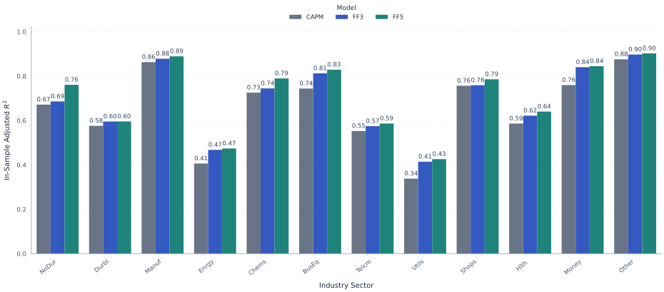
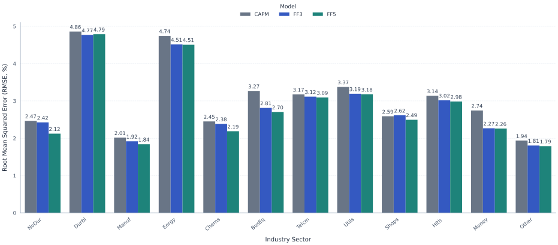

# Cross-Sectoral Sensitivities of Asset Pricing Models

Empirical code for the bachelor thesis *Evaluating Cross-Sectoral Sensitivities of
Asset Pricing Models* (Nico Walendy, Bonn-Rhein-Sieg University of Applied Sciences, 2025).

The thesis compares the CAPM, the Fama-French 3-factor model (FF3) and the
Fama-French 5-factor model (FF5) on 12 U.S. industry portfolios from July 1963 to
December 2024. It asks whether the additional factors explain industry returns
better, both in-sample and out-of-sample.

## Data

Monthly returns in percent from the
[Kenneth R. French Data Library](https://mba.tuck.dartmouth.edu/pages/faculty/ken.french/data_library.html),
downloaded on 2025-02-24:

- Fama-French 3 factors (`MKT`, `SMB`, `HML`, `RF`)
- Fama-French 5 factors (adds `RMW`, `CMA`)
- 12 value-weighted industry portfolios

All files are cut to their common sample of 738 months. The raw files are kept
unchanged in `data/raw/`; the rights to them remain with their author.

## Models

Each model is a time-series regression of the monthly excess return of industry
*i* on the factor returns. $\alpha_i$ is the return the factors do not explain.

**CAPM** (Sharpe 1964, Lintner 1965)

$$R_{i,t} - R_{f,t} = \alpha_i + \beta_{i}^{MKT}\, MKT_t + \varepsilon_{i,t}$$

**Fama-French 3-factor model** (Fama and French 1993)

$$R_{i,t} - R_{f,t} = \alpha_i + \beta_{i}^{MKT}\, MKT_t + \beta_{i}^{SMB}\, SMB_t + \beta_{i}^{HML}\, HML_t + \varepsilon_{i,t}$$

**Fama-French 5-factor model** (Fama and French 2015)

$$R_{i,t} - R_{f,t} = \alpha_i + \beta_{i}^{MKT}\, MKT_t + \beta_{i}^{SMB}\, SMB_t + \beta_{i}^{HML}\, HML_t + \beta_{i}^{RMW}\, RMW_t + \beta_{i}^{CMA}\, CMA_t + \varepsilon_{i,t}$$

**Variables**

| Symbol | Name | Definition | Captures |
|--------|------|------------|----------|
| $R_{i,t}$ | Industry return | Return of industry portfolio *i* in month *t* | – |
| $R_{f,t}$ (`RF`) | Risk-free rate | One-month U.S. Treasury bill rate | – |
| `MKT` | Market | Return of the value-weighted U.S. stock market minus $R_f$ | Systematic market risk |
| `SMB` | Small Minus Big | Return of small-cap minus large-cap stocks | Size premium |
| `HML` | High Minus Low | Return of stocks with high minus low book-to-market ratio | Value premium |
| `RMW` | Robust Minus Weak | Return of firms with high minus low operating profitability | Profitability premium |
| `CMA` | Conservative Minus Aggressive | Return of firms with low minus high asset growth | Investment premium |

A beta measures how strongly an industry's excess return moves with the factor.

## Method

All regressions and tests use Newey-West HAC standard errors with 12 lags.

**In-sample (full sample)**

- OLS regression per model and industry
- Joint Wald test: all factor loadings of a model are zero
- Incremental Wald test: the added factors are zero (CAPM to FF3, FF3 to FF5)
- Assumption diagnostics: linearity, Durbin-Watson, Breusch-Pagan, VIF, ADF
- Stability: the regressions repeated for each decade from the 1970s to the 2010s

**Out-of-sample**

- The loadings for month *t* are estimated on an expanding window of all months
  before *t* (first window 24 months).
- They are applied to the realised factor returns of month *t*. The test therefore
  measures how stable the loadings are, not how well future returns can be forecast.
- Metrics: RMSE and out-of-sample R² (relative to the mean actual excess return)
- Two-sided HAC t-test of a zero mean error per model
- One-sided paired HAC t-test on squared errors between nested models

## Results

| | CAPM | FF3 | FF5 |
|---|---|---|---|
| Average adjusted R² (in-sample) | 0.655 | 0.691 | 0.710 |
| Industries with lower RMSE than the smaller model | – | 11 of 12 | 11 of 12 |

- Market betas differ widely across industries, from 0.53 (Utilities) to 1.25
  (Durables) in the CAPM.
- SMB and HML are jointly significant at the 1% level in 10 of 12 industries.
- RMW and CMA are jointly significant at the 5% level in 10 of 12 industries, but
  raise the average adjusted R² by only 0.02. In some industries, for example
  Durables, they are individually insignificant.
- Out-of-sample, the ranking of the models carries over, but most improvements are
  small. The paired t-test finds a significant gain (5% level) of FF3 over CAPM in
  5 industries and of FF5 over FF3 in 3 industries.





## Pipeline

`run_pipeline.py` runs three stages in order. Stages 2 and 3 both read the
processed data from stage 1. Output files are prefixed with the step that
produces them (`descriptive_`, `in_sample_`, `out_of_sample_`).

**Stage 1: Data** (`--data`, `asset_pricing/data/`)

| Module | Task | Output |
|--------|------|--------|
| `processing.py` | Clean the raw files and cut them to the common sample | `data/processed/*_factors.csv`, `industry_returns.csv`, `reports/tables/data_sample.csv` |
| `loaders.py` | Load the processed data, compute excess returns | – |
| `storage.py` | Read and write the CSV format of `data/` | – |

**Stage 2: In-sample** (`--in-sample`, `asset_pricing/modeling/in_sample/`)

| Module | Task | Output |
|--------|------|--------|
| `descriptive.py` | Summary statistics, distributions, cumulative returns | `descriptive_*` |
| `regression.py` | Full-sample OLS per model and industry | `in_sample_regression_*`, `in_sample_adj_r2.svg`, `reports/summaries/` |
| `wald.py` | Joint and incremental Wald tests | `in_sample_wald_*` |
| `diagnostics.py` | OLS assumption checks and residual plots | `in_sample_diagnostics.csv`, `in_sample_residuals_*` |
| `decades.py` | Regressions per decade | `in_sample_*_by_decade*` |
| `plots.py` | Figures of this stage | – |

**Stage 3: Out-of-sample** (`--out-of-sample`, `asset_pricing/modeling/out_of_sample/`)

| Module | Task | Output |
|--------|------|--------|
| `estimate.py` | Expanding-window estimation of the loadings | `data/interim/*_coefficients.csv` |
| `predict.py` | Prediction for the month after each window | `data/interim/*_predictions.csv` |
| `metrics.py` | RMSE and out-of-sample R² | `out_of_sample_metrics.csv`, `out_of_sample_r2.svg`, `out_of_sample_rmse.svg` |
| `actual_vs_predicted.py` | Scatter plots of actual against predicted returns | `out_of_sample_actual_vs_predicted_*` |
| `forecast_tests.py` | Error t-test and paired t-test | `out_of_sample_error_ttest.csv`, `out_of_sample_paired_ttest.csv` |
| `plots.py` | Figures of this stage | – |

Shared by both modeling stages: `asset_pricing/config.py` (all paths and the
model definitions), `asset_pricing/plot_style.py` (plot style and figure export)
and `asset_pricing/modeling/tables.py` (table export).

All outputs are committed, so the results can be read without running anything.

## Usage

Requires Python 3.12.

```bash
python3.12 -m venv .venv && source .venv/bin/activate
make install        # pinned versions from requirements.txt
make run            # all three stages
make test           # fast tests
make verify         # re-run the pipeline in a temp directory and compare with the committed outputs
make lint           # ruff
```

Single stages: `python run_pipeline.py --data`, `--in-sample` or `--out-of-sample`.

The pipeline is deterministic. With the versions in `requirements.txt`, `make run`
reproduces every committed table, data file and summary byte for byte. Figures can
differ slightly in size depending on the Matplotlib backend.

## Repository structure

```
.
├── run_pipeline.py          Entry point
├── asset_pricing/           Python package (see Pipeline)
├── data/
│   ├── raw/                 Input files (never modified)
│   ├── processed/           Aligned factor and industry returns
│   └── interim/             Expanding-window coefficients and predictions
├── reports/
│   ├── tables/              Results as CSV
│   ├── figures/             Figures as SVG
│   └── summaries/           Regression summaries per model and industry
└── tests/                   Data checks, model checks, full-pipeline comparison
```

## Author

Nico Walendy, Department of Management Sciences, Bonn-Rhein-Sieg University of
Applied Sciences. Supervisors: Prof. Dr. Ralf Meyer and Prof. Dr. Thomas Deckers.
Completed June 2025.

Licensed under the [MIT License](LICENSE).
